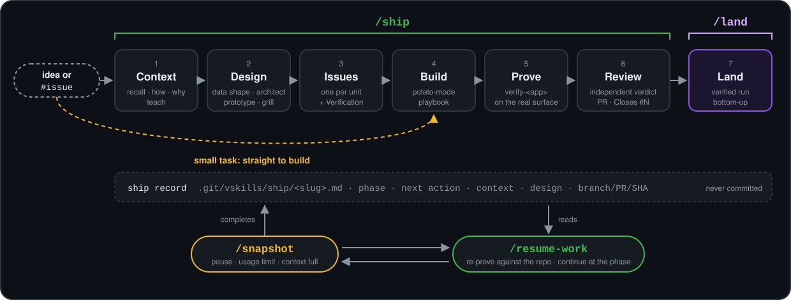

<p align="center">
  
</p>

<p align="center">
  <a href="https://www.npmjs.com/package/@vskills/cli"></a>
  <a href="LICENSE"></a>
  = 18">
  
</p>

<h3 align="center">One skill from idea to merged. <code>/ship</code>, then <code>/land</code>.</h3>

Coding agents are fast. They are also confident, forgetful, and happy to grade
their own homework. vskills wraps them in the process a senior engineer would
run anyway, and packs it into one command:

```
/ship add per-key rate limits to the public API
```

`/ship` works out how big the job is. A small fix goes straight to the build.
A feature gets the whole treatment: it reads what was tried before, explains
the plan to you, settles the design, files the issues, builds them, proves them
on the real surface, and gets a reviewer that didn't write the code to sign
off. Then it hands the PRs to `/land`, which merges them in order and only when
you've said it may.

If you hit a usage limit halfway, `/resume-work` continues at the exact phase it
stopped.

A skill is a `SKILL.md` that an agent loads on demand and that says how to do
one job properly. These run in any harness that can load one (Claude Code,
Cursor, Codex, omp, OpenCode, Pi, T3 Code) with any model. `vskills` is the
zero-dependency installer.

## Quick start

**1. Install.** The same command works on macOS, Linux, and Windows PowerShell:

```
npx @vskills/cli init
```

**2. Set up.** In your agent, run `/setup-vskills`. It installs the
pstack, Addy Osmani, and Matt Pocock skill packs, routes models with
`/setup-pstack`, and offers to give your project a first design, a
verification skill, and an `AGENTS.md`. Restart the harness afterwards.

**3. Ship.**

```
/ship #123
```

That's the whole loop: `/ship` does the work, `/land` merges it,
`/snapshot` and `/resume-work` cover the stops in between. Re-run
`/setup-vskills` any time to update everything.

## How `/ship` works

<p align="center">
  
</p>

`/ship <idea or #issue>` sizes the task and says which way it went. **Small**
means one file or an obvious change, with no design fork and no open product
question, and it goes straight to Build. **Medium** is several files or real
logic that crosses no module boundary or public contract: it runs `/how` on the
touched code, names the data shape, works one issue, then builds, proves, and
gets reviewed like a feature. Everything else is a **feature**, which runs every
phase inside `/ship`, so you never have to call `/grill` or `/issues` yourself.

| # | Phase | What happens |
|---|---|---|
| 1 | **Context** | pstack `/recall` digs up prior chats, PRs, reverted fixes, and symptoms users still report. `/how` and `/why` run in parallel over the code being changed. Then `/teach` walks you through the plan: how it works now, what will change, and why. This is your chance to correct it before any design. |
| 2 | **Design** | Name the data shape first. Anything crossing a module or public contract goes through `/architect`. A fork that running code can settle gets a prototype, not a question. `/grill` asks only the product calls no experiment can settle. A contested design goes through `/interrogate`. |
| 3 | **Issues** | `/issues` files one issue per verifiable unit, in dependency order, each with a Verification-command and the `verify-<app>` feature that proves it. Issues are the durable plan that other people and machines see. |
| 4 | **Build** | pstack `/poteto-mode`'s Feature playbook (Bug-fix for a defect) builds against the named data shape in small ordered commits. The PR names each principle that shaped a decision. |
| 5 | **Prove** | The Verification-command runs after the final edit, then the project's `verify-<app>` skill drives the feature on the real surface. An inconclusive run is not a pass. |
| 6 | **Review** | A context that didn't write the code gives the verdict: your PR bot, a configured reviewer, or `/interrogate`. The PR says `Closes #N`. If a user-facing feature changed, `/maintain-verification-skill` keeps the verify skill's feature map honest. |
| 7 | **Land** | `/land` merges only the contiguous verified run, bottom-up, and only under an explicit grant from you or repo policy. Without one it stops at merge-ready and tells you who needs to merge. |

### The ship record

Every phase boundary rewrites one file:

```
$(git rev-parse --git-common-dir)/vskills/ship/<slug>.md
```

It lives inside `.git`, so it is never committed, never shows up in a diff,
and is shared by every worktree of the repo. It holds the phase, the next
action, the context and design the session learned (with `file:line` anchors,
rejected alternatives, and your grill answers), and a Work table with each
issue's branch, PR, head SHA, and verification state. A record is meant to be
at most one phase stale, so a usage limit costs you minutes, not the
afternoon. `node ~/.agents/skills/ship-record/scripts/ship-record.mjs [slug]` checks a
record's fields and whether its branch still points at the recorded head;
ship, snapshot, land, and resume-work run it after every write and before
every resume.

### Stopping and picking up

| You want to | Run | What it does |
|---|---|---|
| Stop before done | `/snapshot` | Completes the record from live git and tracker state, then hands back `/resume-work <slug>` |
| Continue | `/resume-work` | **Same chat:** re-reads nothing, re-checks git, and continues. **Fresh chat:** the record replaces recall, how, why, and teach. It re-proves every claim against the repo first, then continues at the recorded phase |
| Catch up in chat | `/ketchup` | pstack's "what changed since my last message". It writes no record |

Where the record and the repo disagree, the repo wins. Authority the old
session held (push, merge, comment) expired with it.

### Just one part

Everything above runs inside `/ship`, but each piece also stands alone:

| Skill | Use it for |
|---|---|
| `/grill` | Product questions only. Settle intent without building anything |
| `/issues` | Queue agreed work without building it |
| `/land` | Drive existing PRs to merged: checks, threads, stacks, overnight runs |
| `/ship-record` | Read or check the shared ship record, and say whether it still matches the branch |
| `/investigate` | A read-only answer about the codebase, with file pointers |
| `/debug` | A bug whose cause is unknown. Reproduce first, fix at the cause |
| `/route` | Not sure which one fits? It maps your intent to an invocation |

## Why these exist

Each rule below fixes a failure you hit the moment an agent runs unsupervised.
Most are small principle skills that `/ship` and `/land` invoke, so you can
pull any of them into your own workflow.

### "Done." It isn't.

**Check the real artifact.** Run the feature, read the actual value, and
inspect the diff. A build pass, an HTTP 200, or a summary that says "all tests
pass" is only a proxy. Every issue carries a Verification-command, and the
project's `verify-<app>` skill drives the change the way a user would.
*(`principle-real-artifact`)*

### The agent reviewed its own code and loved it.

**Only an independent verdict counts.** The author checks what it meant to
build, not what it actually built. A verdict covers one patch, so after a push
`/land` compares the patch-id of the full PR diff before it trusts an old
review. *(`principle-independent-verdict`)*

### The tracker says done. Nothing landed.

**The repo beats the report.** When a worker claims success with no commit, or
a ticket says done while the gate is red, the repo is right and the report is
just a story. `/resume-work` re-proves every claim a prior session left before
it builds on it. *(`principle-evidence-over-report`)*

### It retried the same fix eleven times.

**Bound every repair loop.** Retrying an identical failure the same way spends
budget and learns nothing. `/ship` stops repair after three rounds and reports
the blocker instead of weakening acceptance. *(`principle-bounded-repair`)*

### It pushed to a branch it wasn't allowed to touch.

**Name every constraint up front.** That means budget, spend authority, git
authority, tracker access, time, and how far the current state can be trusted.
An unnamed constraint gets violated; a named one picks the path.
*(`principle-named-constraints`)*

### An 800-line diff for a 20-line problem.

**The ladder.** Stop at the first rung that solves it: does it need to exist,
is it already in the codebase, the standard library, the native platform, an
existing dependency, one line, and only then the minimal implementation. Input
validation, error handling, security, and accessibility are never on the
chopping block. *(`ponytail`)*

### "I pushed it." Did you?

**Handoff is not delivery.** `push-handoff` is the explicit delivery step: it
verifies, commits, pushes, and reads the fetched remote SHA back as proof, and
only when delivery is authorized. `/snapshot` checkpoints but grants no push
authority. `/ship` opens the PR and hands it to `/land`, and nothing merges
without your say-so.

## The skills

Install any one with its dependencies: `npx @vskills/cli add <skill>`.

**Delivery**

| Skill | Use when |
|---|---|
| [`ship`](delivery/ship/SKILL.md) | Any task. An idea or issue goes in; it gathers context, designs, files issues, builds, proves, reviews, and hands off to land |
| [`land`](delivery/land/SKILL.md) | PRs need driving to merged. Merges only the contiguous verified run, bottom-up, under an explicit grant |
| [`ship-record`](delivery/ship-record/SKILL.md) | You need the shared ship record read or checked: format, fields, and whether it still matches the branch |

**Standalone**

| Skill | Use when |
|---|---|
| [`snapshot`](standalone/snapshot/SKILL.md) | You're stopping before done. Completes the ship record so a later session needs no fresh recall |
| [`resume-work`](standalone/resume-work/SKILL.md) | A usage limit reset, a paused task, or work another agent claims it finished. Re-proves the record, then continues at its phase |
| [`grill`](standalone/grill/SKILL.md) | You want product questions answered without building yet |
| [`issues`](standalone/issues/SKILL.md) | You want agreed work queued as issues with verification, without building yet |
| [`route`](standalone/route/SKILL.md) | You don't know which skill fits; it hands back an invocation |
| [`investigate`](standalone/investigate/SKILL.md) | You want a read-only answer about the codebase, with file pointers and confidence |
| [`debug`](standalone/debug/SKILL.md) | A bug or regression has an unknown cause. Reproduce, isolate, fix at the cause |
| [`push-handoff`](standalone/push-handoff/SKILL.md) | You need a commit and push under explicit authority, proven by the remote SHA |
| [`ponytail`](standalone/ponytail/SKILL.md) | You want the laziest solution that actually works |
| [`setup-vskills`](standalone/setup-vskills/SKILL.md) | You're installing or updating vskills and the skill packs, routing models, or setting up a project. Re-running it is the update |
| [`setup-obsidian`](standalone/setup-obsidian/SKILL.md) | A docs folder should become a retrieval graph and Obsidian vault |
| [`pr-review`](standalone/pr-review/SKILL.md) | You want a GitHub Actions PR review bot: summary, confidence, checks, fix-on-comment |
| [`test-tps`](standalone/test-tps/SKILL.md) | You're benchmarking a Pi model: TTFT, decode and average TPS, usage, cost, percentiles |

**Pipeline**: disciplines you can pull in on their own.

| Skill | Use when |
|---|---|
| [`audit`](pipeline/audit/SKILL.md) | A whole codebase, not a diff, needs a ranked backlog of tickets |
| [`implementation-tdd`](pipeline/implementation-tdd/SKILL.md) | One ticket, test-first, at the seam production actually uses |
| [`subagent-delegation`](pipeline/subagent-delegation/SKILL.md) | You're fanning work out with disjoint lanes and the parent as sole gatekeeper |
| [`delivery-constraints`](pipeline/delivery-constraints/SKILL.md) | Budget, live data, git authority, or a lying tracker decides how work ships |
| [`ai-subscription-unit-economics`](pipeline/ai-subscription-unit-economics/SKILL.md) | You're setting prices and usage caps for a product whose cost of goods is inference |

**Principles**: invoked by the delivery skills, not entry points.

| Skill | The rule |
|---|---|
| [`principle-real-artifact`](principles/principle-real-artifact/SKILL.md) | Verify against the real thing, never a proxy |
| [`principle-independent-verdict`](principles/principle-independent-verdict/SKILL.md) | Only a context that didn't write the code can pass it |
| [`principle-evidence-over-report`](principles/principle-evidence-over-report/SKILL.md) | When the repo and the report disagree, the repo wins |
| [`principle-bounded-repair`](principles/principle-bounded-repair/SKILL.md) | Budget the fix loop; escalate instead of retrying blind |
| [`principle-named-constraints`](principles/principle-named-constraints/SKILL.md) | Name every constraint before starting |

`ponytail` is vendored from DietrichGebert/ponytail (MIT, pinned to v4.9.0).
See [VENDORED.md](VENDORED.md) for provenance.

### Evals

Skill quality is tested, not asserted. [`evals/`](evals/README.md) runs three
tiers: structural validation and prompt-to-skill routing in CI, plus
on-demand behavioral evals that check whether an agent following the skill
actually does what it promises.

```bash
node scripts/validate-skills.mjs   # tier 1: frontmatter and cross-references
node scripts/run-evals.mjs         # tier 2: does the right skill trigger?
```

## Skills from elsewhere

`/setup-vskills` installs three packs from their upstream repos with
`scripts/install-packs.mjs`. It clones each one into `~/.agents/packs/<pack>`
and pulls them on later runs:

| Pack | What `/ship` uses it for | Source |
|---|---|---|
| pstack | `/recall`, `/how`, `/why`, `/teach`, `/architect`, `/interrogate`, `/poteto-mode`, `/ketchup`, verification skills, `/setup-pstack` | [cursor/plugins](https://github.com/cursor/plugins/tree/main/pstack) |
| Addy Osmani | Lifecycle skills: spec, TDD, security, performance, and more | [addyosmani/agent-skills](https://github.com/addyosmani/agent-skills) |
| Matt Pocock | Engineering and productivity skills | [mattpocock/skills](https://github.com/mattpocock/skills) |

When two skills share a name, the vskills catalogue wins, then pstack, then
Addy Osmani, then Matt Pocock. The losing skill is skipped and reported, so
pstack's `/teach` and `/tdd` stay pstack's. Anything already at a pack skill's
path is left alone and reported; `--force` replaces it, backing up a real
directory first. In Claude Code you can use the pstack plugin instead
(`/plugin install pstack@cursor-plugins`), but not both.

Separately, pinned reference copies of Matt Pocock, Addy Osmani, and Anthropic's
`frontend-design` live under [`third-party/`](third-party/). `vskills init` and
`vskills add` do not install those. Provenance is in [VENDORED.md](VENDORED.md).

## Installing with `vskills`

Zero runtime dependencies, Node 18 or newer.

```bash
npx @vskills/cli init                    # install the recommended set (default)
npx @vskills/cli init --recommended      # exactly the recommended set, dropping anything else
npx @vskills/cli init --all              # install every skill
npx @vskills/cli init --only ship,land   # install exactly these skills
npx @vskills/cli list                    # what is installed, what has drifted
npx @vskills/cli add <skill>             # one skill plus its dependencies
npx @vskills/cli update [skill...]       # refresh, skipping your local edits
```

The recommended set is `ship`, `grill`, `issues`, `snapshot`, `resume-work`,
`setup-vskills`, and `ponytail`. Their dependencies bring in `land`,
`push-handoff`, and four principles, so a fresh machine lands 13 skills,
everything the workflow above needs. On a TTY, `init` shows that set and
offers to accept it (plain Enter), install everything, or pick names. `--yes`
and non-TTY runs take the recommended set without asking.

**Your edits are safe.** A skill whose content hash no longer matches the
manifest is marked `drifted` and left alone. Only `--force` overwrites it, and
it backs the old copy up to `~/.agents/skills/.vskills-backup/` first. Copies
stage in a temp dir and swap in with `rename`, so an interrupted install can't
leave half a skill behind. Every guarantee here is pinned by a test in
[`test/`](test/), which ships in the package.

Content is copied to an install root and linked into each agent's skills
directory:

| | install root | Claude Code target |
|---|---|---|
| macOS / Linux | `~/.agents/skills/<name>` | `~/.claude/skills/<name>` |
| Windows | `%USERPROFILE%\.agents\skills\<name>` | `%USERPROFILE%\.claude\skills\<name>` |

Editing either path edits the same file, and `list` reports it as drifted from
then on. That's the intended way to customise a skill: your version wins until
you ask for it to be overwritten.

<details>
<summary><b>How your selection persists</b></summary>

The choice persists in `.vskills-config.json` under a `selection` key and is
honoured by later `init` and `update` runs without re-prompting. A plain
`update` refreshes only the selection (through its dependency closure) and
retires what dropped out, while `update <name>` stays an explicit, unfiltered
refresh of that name. An explicit flag overrides and rewrites the selection,
and explicit `--recommended` opts back into exactly the tier, dropping anything
else. An install made before selection existed keeps everything already on
disk plus the recommended tier.

The stored value is the `recommended` sentinel, not a frozen list: if the tier
changes, a skill that drops out retires into `.vskills-backup/` on the next run
instead of lingering. `list` marks each row's tier, and `add <skill>` installs
any skill regardless of tier. Discovery only looks at skill directories in the
repo itself and skips `CONTEXT/`, so worktree copies never collide with the
real skills.

</details>

<details>
<summary><b>Windows notes</b></summary>

The commands are the same in PowerShell, but `<` and `>` are reserved, so
replace `<skill>` with a real name.

On Windows, vskills asks for a directory junction, which needs
neither Developer Mode nor an elevated shell, so a stock corporate laptop can
install without a privilege request.

Junctions do have one limit. They are NTFS reparse points and cannot point at a
network location, so a `%USERPROFILE%` redirected to a UNC path or living on a
non-NTFS volume will fail. vskills then retries as a real directory symlink,
which supports remote targets but needs Developer Mode or an elevated shell. If
both fail, the skill still installs into the install root and the run reports
which targets were left unlinked. Re-run `init` once the condition is fixed.

</details>

<details>
<summary><b>npm blocks the install</b></summary>

If npm 12 blocks a GitHub spec with `EALLOWGIT` or `EALLOWREMOTE`, use
`npx --allow-git=all github:vraj-ai/skills init`, or clone the repo and run
`node bin/vskills.js init` with no npm involved.

</details>

### Keeping it current

- `/setup-vskills` updates the catalogue and all three packs in one go.
- `npx @vskills/cli list` shows what is installed and what has drifted.
- `npx @vskills/cli update` refreshes the catalogue and skips anything you edited.
- `npx @vskills/cli update <skill> --force` overwrites an edited skill, backing
  up the old copy first.

Inside T3 Code, `/ship` uses native child tasks, PR links and watches, and
browser evidence. Other hosts use their own native capabilities and say so
when one is missing.

## Contributing

Prove a change before calling it done. This is what the project-local
`.cursor/skills/verify-skills` skill runs, and a model's verdict is not a pass:

```bash
node scripts/validate-skills.mjs && npm test
```

```
bin/              the vskills CLI entrypoint
src/              vskills implementation
test/             vskills test suite (node --test)
evals/            structural, routing, and behavioral skill evals
assets/           README images

delivery/         ship, land
standalone/       route, grill, issues, investigate, debug, snapshot,
                  resume-work, push-handoff, setup-obsidian, setup-vskills,
                  pr-review, ponytail, test-tps
pipeline/         audit, delivery-constraints, implementation-tdd,
                  subagent-delegation, ai-subscription-unit-economics
principles/       principle-real-artifact, principle-evidence-over-report,
                  principle-bounded-repair, principle-named-constraints,
                  principle-independent-verdict
third-party/      pinned Matt Pocock, Addy Osmani, frontend-design packs
.cursor/skills/   project-local verify-skills (not installed by vskills)
```

## Credits

- [pstack](https://github.com/cursor/plugins/tree/main/pstack) by poteto (MIT):
  the inner loop `/ship` runs on. It contributes recall, how, why, teach,
  architect, interrogate, poteto-mode, and the verification skills. It is
  installed beside this catalogue, not vendored into it.
- [mattpocock/skills](https://github.com/mattpocock/skills) by Matt Pocock:
  `/grill-with-docs`, `/to-spec`, `/handoff`, `/to-tickets`, and the shape of
  the workflow. `/grill`, `/issues`, and `/snapshot` are this repo's versions.
- [addyosmani/agent-skills](https://github.com/addyosmani/agent-skills) by Addy
  Osmani: installed as a pack, with a pinned copy under `third-party/`.
- [ponytail](https://github.com/DietrichGebert/ponytail) by DietrichGebert (MIT,
  v4.9.0, commit `0a4dd63ad4541f4f655c4108a295916f3c1d8fda`): the vendored
  decision ladder and the `delete / stdlib / native / yagni / shrink` rubric.
- [OpenAI skills catalog](https://github.com/openai/skills) (reference commit
  `49f948faa9258a0c61caceaf225e179651397431`): reviewed as inspiration for the
  manual-only workflows. No external source text is a dependency of any kept
  skill; see [VENDORED.md](VENDORED.md).

<details>
<summary>The review rubric's lenses came from reading these anti-slop skills</summary>

- [stop-slop](https://skills.sh/hardikpandya/stop-slop) by @hvpandya
- [no-ai-slop](https://skills.sh/petergyang/no-ai-slop/no-ai-slop) by @petergyang
- [humanizer](https://skills.sh/blader/humanizer) by @blader
- [unslop](https://skills.sh/cursor/plugins/unslop) by @poteto, plus Cursor's `deslop` and `thermo-nuclear-code-quality-review`
- [slopbeth](https://skills.sh/ehmo/slopkit/slopbeth) by @synopsi
- [humanizer](https://skills.sh/Aboudjem/humanizer-skill/humanizer) by @AdamBoudj
- [deslop](https://skills.sh/stephenturner/skills/deslop) by @strnr
- [anti-slop](https://skills.sh/elithrar/dotfiles/anti-slop) by @elithrar, plus their `simplify`
- [humanize](https://skills.sh/aashaexo/soundshuman/humanize) by @aashatwt
- [anti-ai-slop-writing](https://skills.sh/jalaalrd/anti-ai-slop-writing/anti-ai-slop-writing) by @jalaal_tweets

</details>

## License

MIT, see [LICENSE](LICENSE).
